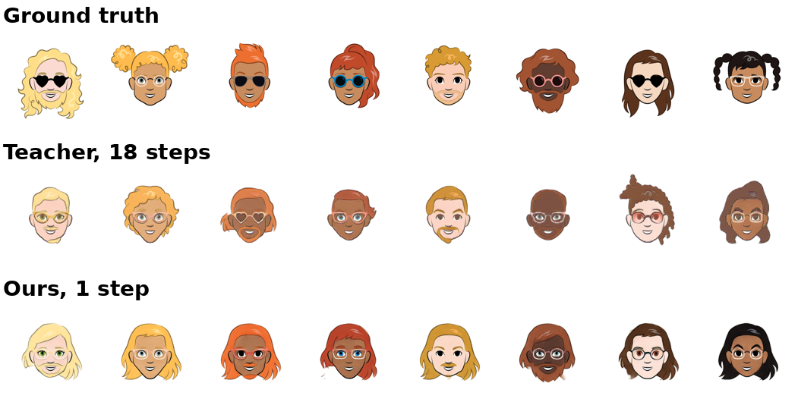

# One-Step Text-to-Image Generation with DMD2

A text-to-image diffusion model trained entirely from scratch, then distilled with Distribution Matching Distillation into a **one-step generator with 46.96M parameters**. It makes a 128×128 image in **31 ms** and scores **FID 35.74**, better than its own 18-step teacher (FID 39.44).




*Rows from top: real images, the 18-step EDM teacher, and our one-step DMD2 generator. Each column uses the same caption, e.g. "gold hair, gray eyes, tan skin, glasses, no beard".*

## Overview

The constraints:
- The generator must be under **50M parameters**, decoder included, and produce an image in **one network evaluation**.
- It must run within **1 second and 8 GB** per image.
- **No pretrained component** may be used in training: no Stable Diffusion, VAE, CLIP, T5 or LPIPS-VGG. Pretrained Inception and CLIP appear only inside the evaluation metrics.

What makes it hard:
- **Diffusion models need many steps.** A good sample normally takes dozens of network evaluations. One-step distillation methods are usually built on top of 860M-parameter pretrained models.
- **Everything starts from random weights.** The autoencoder, the text encoder, the teacher, the "fake" score network and the student are all trained here, on 10,000 images.
- **One-step students tend to collapse or blur.** A student copying the teacher's noise-to-image map usually stays below the teacher's quality, and pure distribution matching can collapse to a few modes.

**Data:** the [Google Cartoon Set](https://google.github.io/cartoonset/) (10,000 faces, CC BY 4.0). Each face is captioned from its attribute file, for example `gold hair, blue eyes, fair skin, glasses, no beard`, with a 26-word vocabulary. 500 captions were frozen once (seed 0) and are used for every metric.

## Method

```
Stage 0  Autoencoder (from scratch): 128×128×3  ──►  16×64×64 latent   (decoder: 0.83M)
Stage A  EDM teacher: text-conditioned latent UNet D(x; σ, c), 10% caption dropout for CFG
Stage B  Paired set: 10,000 (noise, caption) → latent targets via 20 Heun steps, CFG 2
Stage C  DMD2 distillation (generator G initialised from the teacher):
           G(z, c) = D(80·z; σ=80, c)                                    ← a single evaluation
           L_G   = L_DM  +  0.25 · L_reg
           L_DM  : (μ_fake − μ_real) gradient on noised G(z, c)          μ_real = frozen teacher + CFG 2
           L_reg : pseudo-Huber(G(z, c), teacher target) on the paired set
           μ_fake : trained continuously on G's outputs, several steps per G step (DMD2 two-time-scale)
Inference  text encoder → one UNet pass → decoder   (31 ms, 0.32 GB, RTX A6000, batch 1)
```

**Network (46.96M total):**
- Text encoder (3.18M): a 4-layer pre-norm transformer with d = 256 and 4 heads, over a word tokenizer built from the captions. It is trained jointly with the UNet; no CLIP is used.
- Latent UNet (42.95M): ADM-style, channels 128/256/256/256 over resolutions 64 → 32 → 16 → 8. It uses adaptive GroupNorm conditioned on the noise level plus the pooled text, with self-attention and cross-attention to the caption tokens at 32×32 and 16×16.
- Decoder (0.83M): one upsampling stage, from the 64×64 latent to the 128×128 image.

**Training choices:**
- EDM preconditioning, noise schedule and Heun sampler for the teacher.
- DMD's distribution-matching gradient with the paper's normalization.
- **Pseudo-Huber regression in place of LPIPS**, which keeps training free of any pretrained network.
- DMD2's two-time-scale update: the fake score takes several steps per generator step.
- Teacher: 15k iterations at batch 32. DMD: 20k iterations at batch 16. Both use AdamW and bfloat16 on RTX A6000 GPUs.

## Results

Evaluated on the 500 frozen captions with CLIP ViT-B/16 for the CLIP score. One-step parameter counts include the 0.83M decoder.

| Model | NFE | Params | FID ↓ | IS ↑ | CLIP ↑ |
| --- | ---: | ---: | ---: | ---: | ---: |
| EDM teacher, 18 Heun steps | 35 | 46.13M | 39.44 | **2.07** | 28.10 |
| DMD, full recipe | 1 | 46.96M | 41.19 | 1.84 | 28.46 |
| **DMD2, two-time-scale (submitted)** | **1** | **46.96M** | **35.74** | 2.04 | **29.45** |

| Deployment metric (submitted model) | Value |
| --- | --- |
| Latency (RTX A6000, batch 1, bfloat16) | 31 ms per image |
| GPU memory | 0.32 GB |
| Network evaluations | 1 (plus the decoder) |

The one-step student **beats its 35-NFE teacher** on both FID (35.74 vs 39.44) and CLIP score (29.45 vs 28.10).

## Ablations and findings

Each DMD ablation changes one setting and keeps the teacher, paired set, seed and caption list fixed.

| Run (128 px) | FID ↓ | IS ↑ | CLIP ↑ | | Run (64 px) | FID ↓ | IS ↑ | CLIP ↑ |
| --- | ---: | ---: | ---: | --- | --- | ---: | ---: | ---: |
| Teacher, 18 Heun | 39.44 | 2.07 | 28.10 | | Teacher, 18 Heun | 39.34 | 2.48 | 27.82 |
| DMD, full | 41.19 | 1.84 | 28.46 | | DMD, full | 33.89 | 2.29 | 28.55 |
| No regression loss | 66.70 | 1.84 | 27.99 | | No regression loss | 44.39 | 2.47 | 28.99 |
| Regression only | 47.56 | 1.84 | 28.04 | | Regression only | 41.46 | 2.31 | 27.94 |
| CFG 1 | 38.63 | 1.98 | 27.74 | | CFG 1 | 31.91 | 2.33 | 28.02 |
| CFG 4 | 55.37 | 1.88 | 28.42 | | CFG 4 | 38.27 | 2.51 | 28.54 |
| **DMD2 two-time-scale** | **35.74** | 2.04 | **29.45** | | | | | |

- **DMD2's two-time-scale update was the biggest gain.** Giving the fake score more updates per generator step cut FID from 41.19 to 35.74 and raised CLIP from 28.46 to 29.45.
- **Both loss terms are needed.** Without the paired regression loss, FID jumped to 66.70 at 128 px and 44.39 at 64 px. Regression alone beats no regression but is worse than the full objective, so distribution matching adds real value.
- **Guidance strength is a trade-off.** CFG 1 lowered FID compared with the default CFG 2 run at both resolutions, but weakened caption alignment (CLIP). CFG 4 hurt FID. CFG 2 was kept as the default.
- **Resolution.** At 64 px the same recipe scored FID 33.89, but the images are much smaller. The 128 px model was kept as the main result, and its DMD2 version is the best on CLIP.
- **Limitations.** The one-step images are softer than the real drawings: pose and colors come through, fine linework does not. Hairstyle is not in the captions, so it is treated as free variation.

## Repository structure

```
.
├── t2i/
│   ├── models.py          # text encoder + ADM-style latent UNet (T2IDenoiser)
│   ├── edm.py             # EDM preconditioning, loss, Heun sampler
│   ├── vae.py             # autoencoder (encoder / decoder)
│   ├── tokenizer.py       # word tokenizer built from captions
│   └── data.py            # latent / caption datasets
├── curate_cartoon.py      # Cartoon Set attributes → captions
├── curate_anime.py        # alternative anime-faces curation pipeline (explored, not used for the final model)
├── prepare_data.py        # images + captions → tensors, frozen eval caption list
├── train_vae.py           # Stage 0: autoencoder
├── train_latent.py        # Stage A: latent EDM teacher (final pipeline)
├── train_teacher.py       # pixel-space EDM teacher (used in earlier experiments)
├── train_ddpm.py          # vanilla DDPM baseline
├── make_pairs.py          # Stage B: paired regression targets
├── train_dmd.py           # Stage C: DMD / DMD2 distillation
├── export.py              # pack generator + decoder + tokenizer into one checkpoint
├── evaluate.py            # FID, IS, CLIP score, latency
├── eval_cartoon_ckpt.py, sweep_cfg.py
├── run_cartoon.sh, run_cartoon128.sh   # full multi-GPU experiment queues (64 px and 128 px)
├── test.py                # inference: prompts.csv → image_<id>.png
├── checkpoints/generator.pt            # submitted one-step generator (90 MB)
├── eval_captions.json, preview_prompts.json
├── report/report.pdf      # full technical report (CVPR format)
├── report/figures/
├── setup.bash
├── requirements.txt       # inference
└── requirements-train.txt # training + evaluation extras
```

## How to run

**Setup and inference.** This works on a GPU or a CPU (about 0.2 s per image on a laptop CPU).

```bash
bash setup.bash
python test.py --test-prompts /absolute/path/to/prompts.csv --output-dir /absolute/path/to/output_dir
```

`prompts.csv` has a header `id,prompt`, and one `image_<id>.png` is written per row. Prompts use the caption vocabulary, for example `black hair, brown eyes, dark skin, no glasses, beard`. Use `--mode teacher` for the multi-step sampler.

**Reproduce from scratch.** Run `pip install -r requirements-train.txt` first. Download the [Cartoon Set 10k](https://google.github.io/cartoonset/) and unpack it to `data/raw/cartoonset10k/cartoonset10k/`.

```bash
# 1. Captions and 128 px tensors
python curate_cartoon.py
python prepare_data.py --source csv --csv data/raw/cartoon_captions.csv \
    --out data/processed_cartoon128 --res 128

# 2. Autoencoder + latents
python train_vae.py --data data/processed_cartoon128 --out runs/vae_cartoon128 \
    --res 128 --latent-res 64 --epochs 12 --batch 64

# 3. EDM teacher
python train_latent.py --data runs/vae_cartoon128 --vae runs/vae_cartoon128/last.pt \
    --out runs/teacher_cartoon128 --ch 128 --attn-res 32,16 --batch 32 --iters 15000

# 4. Paired regression set
python make_pairs.py --teacher runs/teacher_cartoon128/last.pt \
    --data runs/vae_cartoon128 --vae runs/vae_cartoon128/last.pt \
    --n 10000 --batch 32 --steps 20 --cfg 2

# 5. DMD2 one-step student
python train_dmd.py --teacher runs/teacher_cartoon128/last.pt \
    --pairs runs/pairs_cartoon128.pt \
    --data runs/vae_cartoon128 --vae runs/vae_cartoon128/last.pt \
    --iters 20000 --batch 16 --cfg 2.0 --lambda-reg 0.25 --fake-steps 5 \
    --out runs/dmd_cartoon128_dmd2

# 6. Export the one-step checkpoint
python export.py --src runs/dmd_cartoon128_dmd2/last.pt --vae runs/vae_cartoon128/last.pt \
    --data runs/vae_cartoon128 --dst checkpoints/generator.pt

# 7. Evaluate (FID / IS / CLIP / latency on the 500 frozen captions)
python evaluate.py --ckpt checkpoints/generator.pt --mode onestep \
    --data data/processed_cartoon128 --n 500
```

## Team and acknowledgements

- **Team:** Anshul Kumar Yadav, Sujith Kumar, Alok Kale
- Built for **GNR650: Advanced Topics in Deep Learning for Image Analysis**, Indian Institute of Technology Bombay, under the guidance of **Prof. Biplab Banerjee**.
- Data: [Google Cartoon Set](https://google.github.io/cartoonset/) (Royer et al.), CC BY 4.0. AI coding and writing assistants were used, as declared in the report.

## References

1. T. Yin, M. Gharbi, R. Zhang, E. Shechtman, F. Durand, W. T. Freeman, T. Park. *One-step Diffusion with Distribution Matching Distillation (DMD).* CVPR 2024.
2. T. Yin, M. Gharbi, T. Park, R. Zhang, E. Shechtman, F. Durand, W. T. Freeman. *Improved Distribution Matching Distillation for Fast Image Synthesis (DMD2).* NeurIPS 2024.
3. T. Karras, M. Aittala, T. Aila, S. Laine. *Elucidating the Design Space of Diffusion-Based Generative Models (EDM).* NeurIPS 2022.
4. J. Ho, A. Jain, P. Abbeel. *Denoising Diffusion Probabilistic Models.* NeurIPS 2020.
5. J. Ho, T. Salimans. *Classifier-Free Diffusion Guidance.* arXiv:2207.12598, 2022.
6. P. Dhariwal, A. Nichol. *Diffusion Models Beat GANs on Image Synthesis (ADM).* NeurIPS 2021.
7. R. Rombach, A. Blattmann, D. Lorenz, P. Esser, B. Ommer. *High-Resolution Image Synthesis with Latent Diffusion Models.* CVPR 2022.
8. Y. Song, P. Dhariwal. *Improved Techniques for Training Consistency Models* (pseudo-Huber loss). ICLR 2024.
9. A. Royer et al. *XGAN: Unsupervised Image-to-Image Translation for Many-to-Many Mappings* (Cartoon Set). 2017.
10. M. Heusel et al. *GANs Trained by a Two Time-Scale Update Rule Converge to a Local Nash Equilibrium (FID).* NeurIPS 2017.
11. T. Salimans et al. *Improved Techniques for Training GANs (Inception Score).* NeurIPS 2016.
12. J. Hessel et al. *CLIPScore: A Reference-free Evaluation Metric for Image Captioning.* EMNLP 2021.
